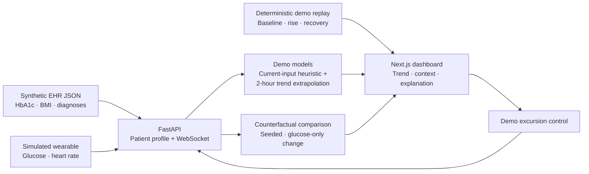

# PulseTwin

**A synthetic-data digital twin proof of concept for exploring diabetes risk monitoring.**

PulseTwin demonstrates how a patient's static clinical context (EHR) and a simulated wearable stream (glucose and heart rate) can be viewed together in a clinician-facing dashboard. It is a research/demo prototype for the Happiest Health Reimagining and Reforming Healthcare in India Summit 2026 Digital Twin Challenge.

> **Safety and data notice:** This prototype uses synthetic patient information and simulated sensor readings. Its transparent rule-based risk index is not a probability, is not clinically validated, and must not be used for diagnosis, treatment, or medication decisions. It is not a medical device.

## Project title and summary

- **Project title:** PulseTwin — A context-aware diabetes digital twin
- **Condition / use case:** Type 2 diabetes; demonstrate a synthetic glucose-excursion forecast over a two-hour horizon, alongside static EHR context and simulated wearable readings.
- **Output:** A live dashboard with readings, an explainable two-hour trend extrapolation, a separate transparent heuristic index, source status, a repeatable guided scenario replay, an excursion control, and JSON/PDF snapshot exports.
- **Data:** `backend/data/ehr.json` is synthetic; the backend generates simulated wearable readings. No real patient data is included.

## Problem statement and healthcare use case

**Problem statement:** Historical EHR information is a clinical snapshot, while changing wearable readings are difficult to interpret without patient context. This proof of concept demonstrates a clinician-facing view that combines a synthetic Type 2 diabetes EHR profile with a simulated glucose and heart-rate stream, then shows an explainable trend-based estimate of glucose two simulated hours ahead.

**Healthcare use case:** Explore how a care team might inspect a synthetic patient's historical HbA1c and BMI alongside incoming wearable readings and a glucose-excursion trend estimate. The prototype is for demonstrating data fusion and model transparency only; it is not a clinical decision-support tool.

## Team and institute

The names below were supplied by the team. Confirm each member's eligibility, registration details, and permission to publish names before making the repository public.

| Submission field | Complete before submission |
|---|---|
| Team name | Binaryspot |
| Team leader and members (1–4 full-time students) | Anuj Nayak (team leader); Shlok Soni |
| College / university | Birla Institute of Technology Mesra |
| Incubator | Not specified |
| Contact email | `[Add approved team contact email if required]` |
| Public GitHub repository | `[Add public repository URL after publishing]` |

## How it works

1. The FastAPI service serves a synthetic EHR profile from `backend/data/ehr.json`.
2. `/ws/stream` emits simulated glucose and heart-rate readings once per second. Each sample advances the synthetic timeline by five minutes so the accelerated demo can illustrate a two-hour horizon.
3. The predictor combines current glucose, change from the previous sample, heart rate, BMI, and historical HbA1c into a separate deterministic 0–1 **current-input heuristic index** with inspectable component contributions.
4. A second, distinct model fits a least-squares line to up to 12 five-minute glucose samples and extrapolates 120 simulated minutes. It reports the projected glucose, trend slope, estimated threshold-crossing time, and whether the illustrative 180 mg/dL threshold is projected to be crossed within the horizon. At least three readings are required. HbA1c, BMI, and current heart rate are also combined with the projected value in a separately labelled contextual demo index; that index is not a probability.
5. The Next.js dashboard plots the incoming stream and dashed two-hour extrapolation, displays EHR context and model factors, and can inject a simulated upward glucose excursion.
6. If the backend is unavailable, the dashboard offers a clearly labelled local synthetic stream and computes the same demonstration extrapolation locally.
7. **Run guided replay** plays the same 32-step synthetic baseline → rising signal → elevated signal → recovery scenario on every run (about 29 seconds). It is accelerated for a short presentation and is generated locally; it is not real patient data.
8. **Counterfactual Twin Lab** calls `POST /api/counterfactual` to compare seeded synthetic scenarios for the same static profile. The heart-rate sequence is held constant while only the glucose trajectory changes; the comparison includes each scenario's two-hour trend projection as well as the separate current-input heuristic. It is deterministic for a given seed and sample count and does not model treatment, medication, or clinical outcomes.

**Scope and limitations:** The two-hour output is a simple linear extrapolation over synthetic data, not a trained model, clinical forecast, probability, or treatment recommendation. The 180 mg/dL crossing threshold is an illustrative project setting, not a clinical cutoff. There are no labelled adverse-event outcomes, external validation, calibration, or established predictive performance.

### Architecture



## Technical stack

| Layer | Technology |
|---|---|
| Clinician dashboard | Next.js App Router, React, TypeScript, Recharts, Lucide, jsPDF |
| API and sensor simulation | Python, FastAPI, Pydantic, WebSockets |
| Current-input index | Deterministic rule-based heuristic; no training or external dataset |
| Glucose excursion forecast | Least-squares linear trend extrapolation over up to 12 synthetic samples; 120-minute horizon; no training or external dataset |
| Data | Locally stored synthetic EHR JSON and generated sensor readings |

## AI/ML model and framework details

This PoC uses Python with a FastAPI backend and a TypeScript/Next.js dashboard. It does **not** train or load a machine-learning model. It has two separate, transparent demonstration calculations:

1. **Current-input heuristic:** a weighted rule-based score from current glucose, short-term glucose change, historical HbA1c, BMI, and heart rate; the UI shows each component.
2. **Two-hour glucose trend estimate:** least-squares linear regression over up to 12 synthetic glucose samples, spaced five simulated minutes apart. It reports a 120-minute extrapolated glucose, slope, estimated time to cross the illustrative 180 mg/dL threshold, and crossing status after at least three samples. A separate contextual demo index applies the static EHR HbA1c/BMI and current heart rate to the projected glucose.

These calculations are demonstration logic—not trained models, probabilities, clinical cutoffs, or clinically validated forecasts. No training data, labelled clinical outcomes, or model performance metrics are claimed.

### Heuristic definition

The score is clamped to `[0, 1]` and combines these weighted components:

- Glucose above 110 mg/dL: up to `0.45`
- Positive change from the previous sample: up to `0.25`
- Baseline HbA1c above 5.7%: up to `0.25`
- BMI above 25: up to `0.10`
- Heart rate above 90 bpm: up to `0.10`

The weights and thresholds are demonstration choices, not clinical thresholds. The dashboard's severity bands are low `< 0.35`, moderate `0.35–0.64`, and high `≥ 0.65`. The dashboard displays the individual component contributions so viewers can inspect how the synthetic baseline and simulated readings affect the demo index. No sensitivity, specificity, calibration, or clinical utility has been established.

## Run locally

Prerequisites: Node.js 20.9+ and Python 3.9+.

### 1. Start the API

```powershell
cd backend
python -m venv .venv
.\.venv\Scripts\Activate.ps1
pip install -r requirements.txt
uvicorn main:app --reload
```

The API is available at `http://localhost:8000`; interactive API documentation is at `http://localhost:8000/docs`.

### 2. Start the dashboard

In another terminal:

```powershell
cd frontend
npm install
npm run dev
```

Open `http://localhost:3000`. Use **Compare scenarios** in the Counterfactual Twin Lab to request the deterministic backend comparison; this feature requires the API. Use **Run guided replay** for a short, repeatable baseline-to-excursion-to-recovery walkthrough that works without a running API. Use **Start live stream** to receive backend readings, or use the excursion control to see the trend and two-hour extrapolation respond. Simulated samples advance five minutes at a time. The dashboard distinguishes a backend stream from its local fallback and marks local synthetic patient data separately. If the API is unavailable, the local demo stream remains available and is labelled as such.

Use **Export JSON** for the raw snapshot or **Export PDF** for a shareable, paginated demonstration report with patient context, the latest readings, the separate two-hour trend projection, heuristic components, scenario status, replay phase labels, counterfactual summary and paired readings, and recent samples. Both exports are synthetic demo artifacts and include a prominent non-clinical-use notice.

### Verify the demo models

From the `backend` directory, run:

```powershell
python -m unittest discover -s tests -v
```

These tests check the documented output shape, heuristic severity and bounds, sample sufficiency, trend projection behavior, EHR-contextualized index, and repeatability of counterfactual scenarios. They are software behavior checks only; they are not clinical validation or evidence of predictive accuracy.

### Suggested live-demo flow

1. Point out that the EHR profile and all sensor readings are synthetic.
2. Run the guided replay and point out that each synthetic sample represents five simulated minutes.
3. Show the dashed two-hour projection line and the event status as the synthetic glucose rises; explain the 12-sample linear extrapolation and illustrative threshold.
4. Compare the current-input heuristic index with the forecast's contextual index. Point out how historical HbA1c and BMI from the synthetic EHR combine with current heart rate and projected glucose in the latter.
5. Run the Counterfactual Twin Lab and show that it keeps the same profile and heart-rate sequence while changing only synthetic glucose inputs; compare the resulting trend projections.
6. Optionally start the API stream, demonstrate the excursion control, and identify the backend stream source label.
7. Export both formats and show the forecast metadata, scenario comparison, and non-clinical-use notice in the PDF.
8. Close with the limits and evaluation plan below. Do not describe the demonstration extrapolation as accuracy, a probability, or a clinically validated prediction.

To point the frontend at another API origin, set `NEXT_PUBLIC_API_URL` when starting the Next.js app. The backend permits the two standard local frontend origins by default. For a different local or deployed frontend, set `FRONTEND_ORIGINS` to a comma-separated allowlist (for example, `https://your-dashboard.example`). Cookie credentials are not enabled.

### Submission documents

- Architecture diagram: [docs/architecture.pdf](./docs/architecture.pdf)
- Project presentation: [docs/project-presentation.pdf](./docs/project-presentation.pdf)
- Folder name per challenge instructions: `Binaryspot_Birla Institute of Technology Mesra`
- Regenerate the PDFs after project changes with `node tools\generate_submission_pdfs.mjs`.

**Demonstration outcome:** In the seeded counterfactual software test, the steady synthetic glucose trace ends without a projected threshold crossing, while the rising trace crosses the illustrative threshold during its rise. This confirms only that the scripted inputs exercise the implemented rule as expected. It is not a clinical outcome, an accuracy result, or evidence that the forecast works on real patients.

## Required README submission items

The challenge submission form requires every item below to be included in the public repository README. Current status is shown honestly; do not mark video or public-access items complete until the team has supplied and checked them.

| Required item | Status and README location |
|---|---|
| Team details | Included above: Binaryspot; Anuj Nayak (team leader); Shlok Soni. Confirm member consent, eligibility, and registered details before publishing. |
| College / incubator information | College included above: Birla Institute of Technology Mesra. Confirm the incubator entry with the team and update it above (or state “Not applicable”). |
| Project title | Included above: PulseTwin — A context-aware diabetes digital twin. |
| Problem statement | Included above under “Problem statement and healthcare use case.” |
| Healthcare use case | Included above under “Problem statement and healthcare use case.” |
| Technical stack | Included above under “Technical stack.” |
| AI/ML model or framework details | Included above under “AI/ML model and framework details”; accurately states that the prototype does not train an ML model. |
| 15–20 minute demo video, uploaded as an unlisted YouTube video, with link in README | **Pending team action.** Record a 20-minute walkthrough and replace the placeholder below with the unlisted video URL. This targets the upper end of the form's duration range and meets the challenge brief's 20-minute minimum. |
| Open-source license details | Included below: MIT License, linked to the repository's `LICENSE` file. |
| Architecture diagram in PDF/PPT | Included: [docs/architecture.pdf](./docs/architecture.pdf). |
| Presentation in PDF/PPT covering project details and outcomes | Included: [docs/project-presentation.pdf](./docs/project-presentation.pdf). The demonstration outcome is described above and explicitly separated from clinical validation. |
| All files and links publicly accessible without extra permissions | **Pending final check.** Once published, verify the repository is Public and open every linked file/video in a signed-out or private browser window. Add the public repository URL above. |

### Required demo video link

**Unlisted YouTube video (target duration: 20 minutes):** `[Add the unlisted YouTube URL after recording and uploading]`

Suggested 20-minute run of show: problem and intended user (3 min), synthetic data and privacy (3 min), architecture and model (4 min), working dashboard and scenarios (7 min), limitations, evaluation plan, and next steps (3 min).

### Final pre-submission checks

- [ ] Confirm team-member consent, full-time student eligibility, and registration information.
- [ ] Confirm incubator status and replace the placeholder if applicable.
- [ ] Record/upload the 20-minute video and replace the video-link placeholder above.
- [ ] Add the real public GitHub URL to the team table.
- [ ] Confirm the repository is Public and every PDF, README link, and video URL opens without requesting extra permissions.
- [ ] Run the prototype from a clean setup and capture genuine outputs; do not present demo indices or synthetic forecast behavior as measured model accuracy.
- [ ] Use the required folder name: `Binaryspot_Birla Institute of Technology Mesra`.

## Evaluation plan and next steps

This PoC has no validated outcome labels or benchmark results. Its automated checks establish only that the demo implementations behave consistently with their stated rules; they do not establish clinical value or predictive performance. A responsible next phase would be to evaluate a documented, appropriately licensed open or synthetic dataset with labelled events; compare the linear extrapolation to suitable baselines; split by patient to prevent leakage; report calibration and clinically relevant metrics; and obtain domain-expert review. No real identifiable patient data should be added to this public repository.

Potential extensions include a reproducible synthetic data generator, trend-aware sequence models evaluated against simple baselines, an audit trail for alerts, clinician feedback, and a clearly separated offline replay mode.

## License

The source code is released under the MIT License; see [LICENSE](./LICENSE). Synthetic demo data is provided for demonstration only.
